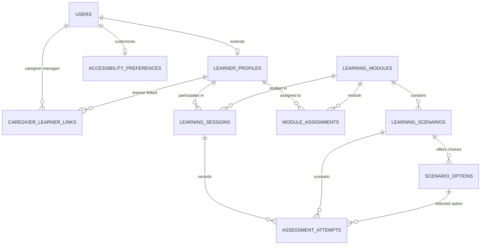

# NeuroVR-2.0 Database Architecture

NeuroVR-2.0 is designed with a normalized relational database schema supporting both **PostgreSQL** in production/staging and an **in-memory relational store** for resilient local offline development and continuous testing.

---

## Relational Schema Diagram



---

## Tables and Specifications

### 1. `users`
- `id` (UUID, Primary Key)
- `email` (VARCHAR(255), Unique, Not Null)
- `password_hash` (VARCHAR(255), Not Null) - bcrypt hashed
- `name` (VARCHAR(255), Not Null)
- `role` (VARCHAR(50), Not Null) - `caregiver`, `learner`, `admin`
- `created_at` / `updated_at` (TIMESTAMP)

### 2. `learner_profiles`
- `id` (UUID, Primary Key)
- `user_id` (UUID, Foreign Key -> `users.id`)
- `age` (INTEGER)
- `disability_type` (VARCHAR(255))
- `support_notes` (TEXT)
- `safety_awareness_level` (VARCHAR(50)) - `Emerging`, `Developing`, `Proficient`
- `created_at` / `updated_at` (TIMESTAMP)

### 3. `caregiver_learner_links`
- `id` (UUID, Primary Key)
- `caregiver_id` (UUID, Foreign Key -> `users.id`)
- `learner_id` (UUID, Foreign Key -> `learner_profiles.id`)
- `relationship_type` (VARCHAR(100)) - `Special Educator`, `Parent`, `Guardian`
- `created_at` (TIMESTAMP)

### 4. `learning_modules`
- `id` (UUID, Primary Key)
- `title` (VARCHAR(255), Not Null)
- `description` (TEXT)
- `difficulty_level` (VARCHAR(50)) - `beginner`, `intermediate`, `advanced`
- `estimated_duration_minutes` (INTEGER)
- `order_index` (INTEGER)
- `is_active` (BOOLEAN DEFAULT TRUE)

### 5. `learning_scenarios`
- `id` (UUID, Primary Key)
- `module_id` (UUID, Foreign Key -> `learning_modules.id`)
- `title` (VARCHAR(255), Not Null)
- `prompt_text` (TEXT, Not Null)
- `guidance_speech` (TEXT) - Text read aloud via Web Speech API
- `scene_environment` (VARCHAR(100)) - `classroom`, `park`, `hallway`, `living_room`
- `bubble_radius` (NUMERIC) - Space bubble distance threshold in meters
- `order_index` (INTEGER)

### 6. `scenario_options`
- `id` (UUID, Primary Key)
- `scenario_id` (UUID, Foreign Key -> `learning_scenarios.id`)
- `option_text` (TEXT, Not Null)
- `is_safe` (BOOLEAN, Not Null) - Identifies safe choice
- `feedback_text` (TEXT, Not Null) - Immediate constructive guidance
- `encouragement_note` (TEXT) - Trauma-informed reinforcement
- `order_index` (INTEGER)

### 7. `module_assignments`
- `id` (UUID, Primary Key)
- `learner_id` (UUID, Foreign Key -> `learner_profiles.id`)
- `module_id` (UUID, Foreign Key -> `learning_modules.id`)
- `repetition_count` (INTEGER DEFAULT 2) - Number of practice runs required
- `difficulty_level` (VARCHAR(50))
- `status` (VARCHAR(50)) - `pending`, `in_progress`, `completed`

### 8. `learning_sessions`
- `id` (UUID, Primary Key)
- `learner_id` (UUID, Foreign Key -> `learner_profiles.id`)
- `module_id` (UUID, Foreign Key -> `learning_modules.id`)
- `session_type` (VARCHAR(50)) - `guided_lesson`, `independent_practice`
- `assisted_by_caregiver` (BOOLEAN DEFAULT FALSE)
- `duration_seconds` (INTEGER)
- `score_percentage` (NUMERIC)
- `created_at` / `completed_at` (TIMESTAMP)

### 9. `assessment_attempts`
- `id` (UUID, Primary Key)
- `session_id` (UUID, Foreign Key -> `learning_sessions.id`)
- `scenario_id` (UUID, Foreign Key -> `learning_scenarios.id`)
- `option_id` (UUID, Foreign Key -> `scenario_options.id`)
- `is_safe_choice` (BOOLEAN)
- `reaction_time_ms` (INTEGER)
- `assisted` (BOOLEAN)
- `created_at` (TIMESTAMP)

### 10. `accessibility_preferences`
- `id` (UUID, Primary Key)
- `user_id` (UUID, Foreign Key -> `users.id`)
- `high_contrast` (BOOLEAN)
- `contrast_theme` (VARCHAR(50)) - `normal`, `high_contrast_yellow`, `high_contrast_dark`
- `text_scale` (VARCHAR(50)) - `normal`, `large`, `xlarge`
- `tts_enabled` (BOOLEAN)
- `tts_speed` (NUMERIC)
- `reduced_motion` (BOOLEAN)
- `caregiver_assistance_mode` (BOOLEAN)

---

## Migration and Seeding

Run database migrations and seeds with:
```bash
npm run seed --prefix server
```
If a PostgreSQL connection string is supplied via `DATABASE_URL`, SQL schema tables are automatically provisioned. If PostgreSQL is offline, the resilient embedded relational engine initializes automatically with full demo seed data.
